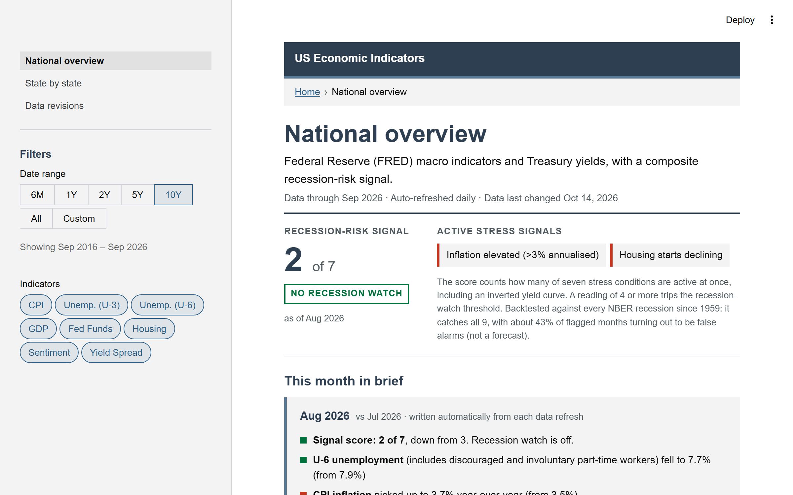
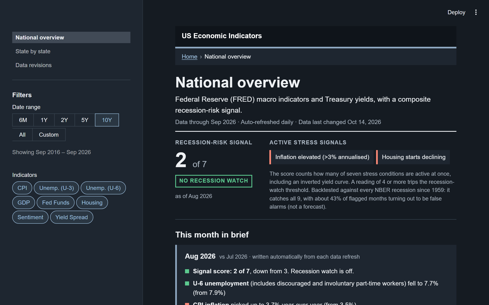

# Economic Indicators Pipeline

An end-to-end data pipeline over 160+ Federal Reserve (FRED/ALFRED) data
series: national macro indicators with a backtested recession-risk signal
and an auto-written monthly briefing, state-level unemployment, house
prices, and income for all 50 states + DC, and point-in-time vintage data
showing how first-print numbers were later revised. Ingestion and
transformation feed dbt models, and a three-page Streamlit dashboard serves
the result, refreshed daily by a scheduled GitHub Actions workflow.

**Live dashboard:** https://ajaiah-d-economic-indicators-pipeline-dashboardapp-d8tih5.streamlit.app/

---

## Architecture

1. **Ingestion** (`ingestion/`) pulls from the FRED API and writes timestamped CSVs to S3: `fetch_fred.py` for the nine national series, `fetch_fred_states.py` for ~150 state-level series (rate-limited batch), and `fetch_fred_vintages.py` for ALFRED vintage data -- every value each series has ever published.
2. **Orchestration** in production is the GitHub Actions workflow in step 6. `dags/fred_ingestion_dag.py` is an Airflow DAG (TaskFlow API, one fetch/write task pair per indicator, retries with exponential backoff) for running the national ingestion locally; nothing schedules it. A test keeps its series list identical to the ingestion script's.
3. **Transform** (`spark/`) reads the raw CSVs and writes processed Parquet back to S3: national wide table with MoM % change, 3-month rolling averages, and the 10Y-3M Treasury spread; a long state table with per-state YoY changes computed at each indicator's native frequency; and a long vintage table keyed by (series, observation date, release date).
4. **Modeling** (`dbt/`) builds staging views and materialized marts with dbt-duckdb: the national mart adds seven binary stress flags + a composite signal score, the state mart adds per-date ranks across the 51-state field, and the vintage mart adds first-print / latest-revision window columns.
5. **Dashboard** (`dashboard/`) is a multi-page Streamlit + Plotly app -- see "Dashboard pages" below.
6. **Refresh** (`.github/workflows/refresh_data.yml`) runs ingestion, transform, dbt and the snapshot export daily and commits small snapshots back to the repo, so the deployed dashboard normally has current data without needing any credentials at deploy time.

## Dashboard pages

- **National overview**: KPI tiles, per-indicator trends, the recession-risk
  signal with flag-history heatmap, and a **monthly briefing written
  automatically from the data**: it diffs the latest complete month against
  the prior one and scans each series' full history so it can say "housing
  starts fell 15%, the sharpest monthly drop since 2024, activating a stress
  flag" instead of just showing numbers. Unemployment is shown as both
  **U-3** (the standard headline rate) and **U-6** (adds discouraged
  workers and involuntary part-time employment, a broader read on labor
  slack) side by side; the recession-signal flag stays keyed to U-3 since
  that's what it was backtested against.
- **State by state**: unemployment (monthly), FHFA house-price growth
  (quarterly), and per-capita income (annual) for all 50 states + DC; each
  state ranked against the field, charted against the U.S., and mapped on a
  choropleth.
- **Data revisions**: built on ALFRED vintage data. GDP growth and payroll
  gains as first reported vs today's estimate (computed within vintages, so
  benchmark rebasings of the level can't distort it), NBER recessions shaded
  on every chart, and a "time machine" that reconstructs unemployment,
  housing starts, or payrolls exactly as they looked on any chosen date --
  e.g. the economy as visible in September 2008 vs what we now know was
  happening, with a table of the biggest then-vs-now gaps in that window.

### Look and feel

The dashboard uses a plain official-statistics style, in the spirit of
GOV.UK and Rijksoverheid: Arial, square corners, and rules and grey panels
instead of shadows. It has a light and a dark mode. It follows your system
setting, and you can switch with the ⋮ menu (top right): System, Light or
Dark. Arrows on the stat tiles always point the way the number moved, and
their colour says whether that move is good for the economy (green), bad
(red) or neither (grey). The value is always shown as text too.

| Light | Dark |
|---|---|
|  |  |

After a switch from the menu, the page's own panels change straight away.
The Plotly charts pick up the new colours on your next click, because
Streamlit only tells the app the mode when it reruns.

## FRED Indicators

| Series ID   | Label                | Frequency | Units                    |
|-------------|----------------------|-----------|--------------------------|
| CPIAUCSL    | CPI                  | Monthly   | Index (1982-84 = 100)    |
| UNRATE      | Unemployment Rate (U-3) | Monthly | Percent                |
| U6RATE      | Unemployment Rate (U-6) | Monthly | Percent                |
| GDP         | GDP                  | Quarterly | Billions of USD          |
| FEDFUNDS    | Fed Funds Rate       | Monthly   | Percent                  |
| HOUST       | Housing Starts       | Monthly   | Thousands of units       |
| UMCSENT     | Consumer Sentiment   | Monthly   | Index                    |
| GS10        | 10-Year Treasury     | Monthly   | Percent                  |
| TB3MS       | 3-Month Treasury     | Monthly   | Percent                  |

GS10 minus TB3MS gives the yield-curve spread used in the recession signal below.

Beyond these, the pipeline also ingests:

- **State-level** (~150 series): `{ST}UR` unemployment rate (monthly), `{ST}STHPI`
  FHFA all-transactions house price index (quarterly), and `{ST}PCPI` per-capita
  personal income (annual) for all 50 states + DC. State-level unemployment is
  U-3 only -- BLS's state-level U-6 series (e.g. `U6UNEM6CA`) are quarterly,
  not seasonally adjusted, reported as a 4-quarter moving average, and run
  over a year stale, too different in kind from the current monthly U-3 data
  to mix into the same page without misleading readers.
- **Vintages** (ALFRED): every value ever published for GDP, PAYEMS (nonfarm
  payrolls), UNRATE, and HOUST -- one row per (observation date, release date).

## Project Structure

```
Economic-Indicators-Pipeline/
├── ingestion/
│   ├── fetch_fred.py                  national series -> S3
│   ├── fetch_fred_states.py           ~150 state series -> S3 (rate-limited)
│   └── fetch_fred_vintages.py         ALFRED vintage data -> S3
├── dags/
│   └── fred_ingestion_dag.py          Airflow DAG (TaskFlow API)
├── spark/
│   ├── transform_indicators.py        PySpark version, for a Databricks cluster
│   ├── transform_indicators_local.py  pandas equivalent, used by the daily refresh
│   ├── transform_states_local.py      state long table + per-state YoY changes
│   └── transform_vintages_local.py    vintage long table (obs date x release date)
├── dbt/
│   ├── dbt_project.yml
│   ├── profiles.yml
│   └── models/
│       ├── staging/                   stg_fred_indicators, stg_state_indicators,
│       │                              stg_fred_vintages
│       ├── intermediate/int_indicator_trends.sql
│       └── marts/                     economic_dashboard, state_dashboard,
│                                      vintage_dashboard
├── dashboard/
│   ├── app.py                         entry point + national page + navigation
│   ├── briefing.py                    auto-written monthly briefing engine
│   ├── states_view.py                 state-by-state page
│   ├── revisions_view.py              data-revisions page
│   ├── theme.py                       light/dark tokens, palettes, chart layout
│   └── ui.py                          page CSS and HTML blocks
├── scripts/
│   ├── backtest_signal.py             reproduces the recession-signal backtest
│   ├── export_dashboard_snapshot.py   dbt marts -> committed Parquet snapshots
│   └── screenshot_dashboard.py        light/dark screenshots for visual review
├── tests/                              pytest suite (run in CI)
├── data/
│   ├── economic_dashboard.parquet     committed snapshots, refreshed daily
│   ├── state_dashboard.parquet
│   ├── vintage_dashboard.parquet
│   └── last_updated.json
├── docs/screenshots/                  README screenshots
├── .github/workflows/
│   ├── refresh_data.yml               daily ingest -> transform -> dbt -> snapshot
│   └── tests.yml                      pytest on pushes to main and pull requests
├── .env.example
├── requirements.txt                   dashboard runtime only
├── requirements-dev.txt               pytest and test-only imports
├── requirements-refresh.txt           pinned install for the daily refresh
└── requirements-pipeline.txt          full pipeline (Airflow, PySpark, dbt)
```

## Setup

### Prerequisites

- Python 3.12 (Airflow and PySpark don't support the newest Python releases)
- An AWS account with an S3 bucket and an IAM user scoped to that bucket (`s3:GetObject` / `s3:PutObject` / `s3:ListBucket`)
- A FRED API key (free at [fred.stlouisfed.org](https://fred.stlouisfed.org/docs/api/api_key.html))

### 1. Clone and install dependencies

```bash
git clone <repo-url>
cd Economic-Indicators-Pipeline
python -m venv .venv
source .venv/bin/activate          # Windows: .venv\Scripts\activate
pip install -r requirements-pipeline.txt
```

`requirements.txt` is the slim runtime Streamlit Community Cloud installs for
the dashboard alone, deliberately skipping Airflow, PySpark, and dbt so the
hosted build stays fast. Use `requirements-pipeline.txt` for full local
development.

### 2. Configure credentials

```bash
cp .env.example .env
# fill in FRED_API_KEY, AWS_ACCESS_KEY_ID, AWS_SECRET_ACCESS_KEY, AWS_BUCKET_NAME, AWS_REGION
```

## Running each stage

### 1. Ingest from FRED to S3

```bash
python ingestion/fetch_fred.py           # 9 national series
python ingestion/fetch_fred_states.py    # ~150 state series (takes ~90s, rate-limited)
python ingestion/fetch_fred_vintages.py  # ALFRED vintages for 4 series
```

Each uploads timestamped CSVs to `s3://<AWS_BUCKET_NAME>/raw/`.

### 2. Run the Airflow DAG locally

Apache Airflow doesn't run natively on Windows; use WSL2 or a Linux/Mac shell.

```bash
export AIRFLOW_HOME=$(pwd)/airflow-home
airflow standalone

# in a second terminal
airflow dags trigger fred_economic_ingestion
airflow dags list-runs -d fred_economic_ingestion
```

The web UI is at `http://localhost:8080` (default user: `admin`).

### 3. Transform: local pandas or PySpark on Databricks

The daily refresh workflow uses the local pandas versions, since the datasets
are tens of thousands of rows at most and a Spark cluster isn't buying
anything at this scale:

```bash
python spark/transform_indicators_local.py
python spark/transform_states_local.py
python spark/transform_vintages_local.py
```

`spark/transform_indicators.py` is a PySpark version of the national
transform, written for a larger dataset on a Databricks cluster (Databricks
Free Edition dropped support for all-purpose clusters, so it now needs a
Unity Catalog external location to reach S3 rather than a simple access key).
The daily refresh does not run it, and it is not an exact twin: when the same
date appears in several raw snapshots, the pandas job keeps the most recent
snapshot's value, while the Spark job's `dropDuplicates` keeps an arbitrary
one. Either way, the output lands at
`s3://<bucket>/processed/economic_indicators/`.

### 4. Run dbt models

dbt reads the S3 Parquet directly through dbt-duckdb's `httpfs` extension.
`dbt/profiles.yml` is already checked in and only references environment
variables, so no manual profile setup is needed:

```bash
cd dbt
dbt build
```

`dbt build` runs the models and then the data tests: not-null keys on each
mart, a unique date on the national mart, one-row-per-key checks on the state
and vintage grains, the signal score equalling the count of active flags, the
GDP flag held for all three months of a quarter, all 51 states present, and a
freshness check that fails if the newest month is over 120 days old.
The daily workflow runs the same command, so a failing test blocks the
snapshot from being committed.

### 5. Export the dashboard snapshot

```bash
python scripts/export_dashboard_snapshot.py
```

Copies the dbt mart tables to `data/*.parquet` (national, state, vintage)
and writes `data/last_updated.json` (timestamp, row counts, date ranges).
These are the files a deployed dashboard actually reads.

### 6. Launch the dashboard

```bash
streamlit run dashboard/app.py
```

The national page loads data in this order: `dbt/target/economic_dashboard.parquet`
if that file exists (no script in this repo writes it, so normally it does
not), then the committed snapshot in `data/`, then S3 (if `AWS_*` env vars
are set), then synthetic demo data as a last resort so the UI is still
browsable with zero setup.

To check the look in both modes, `scripts/screenshot_dashboard.py` starts
the app and saves light, dark and phone-width screenshots of every page. It
needs a Python with Playwright and Chromium (`pip install playwright` and
`playwright install chromium`):

```bash
python scripts/screenshot_dashboard.py   # saves to <temp>/eip-screenshots; --out DIR to change
```

## Automated daily refresh

`.github/workflows/refresh_data.yml` runs steps 1, 3, 4, and 5 above on a
schedule (cron set to 12:00 UTC daily, plus manual `workflow_dispatch`;
GitHub usually starts it later, anywhere from 12:00 to 22:00 UTC) and commits
the result back to the repo. This is what keeps the deployed dashboard
current without it ever needing AWS credentials at deploy time; it just reads
the committed snapshot.

The workflow commits only when a snapshot's contents changed. The export
leaves out dbt's build timestamp, and the run-time metadata file is only
committed alongside a real data change, so on days FRED publishes nothing
there is no commit and the dashboard's "last update" date stays put.

If any series fails to fetch or upload, the ingestion script still attempts
the rest, then exits non-zero. That fails the workflow before transform and
export, so the dashboard keeps yesterday's snapshot (and its "last update"
date) instead of publishing a partly stale one, and GitHub emails the
failure to the repository owner.

**One-time setup:** add these as repository secrets (Settings → Secrets and
variables → Actions). The workflow pushes with the default `GITHUB_TOKEN`,
no extra token needed for that part:

- `FRED_API_KEY`
- `AWS_ACCESS_KEY_ID`
- `AWS_SECRET_ACCESS_KEY`
- `AWS_BUCKET_NAME`
- `AWS_REGION`

## Recession-risk signal

Seven binary stress flags are checked each month, and the signal score is
just how many are active at once, 0-7:

| Flag                        | Condition                                                     |
|------------------------------|-----------------------------------------------------------------|
| Unemployment rising          | 3-month avg > 3-month avg from 3 months prior                   |
| GDP contracting              | Nominal GDP quarter-over-quarter change < 0, from the latest quarter already published |
| Inflation elevated           | CPI 12-month change > 3%                                        |
| Fed rate elevated            | Effective funds rate > its own trailing 3-year average + 1pt    |
| Housing starts declining     | 3-month avg < 3-month avg from 3 months prior                    |
| Consumer sentiment falling   | 3-month avg < 3-month avg from 3 months prior                    |
| Yield curve inverted         | 10Y minus 3M Treasury spread < -0.25pt                           |

A score of 4 or more trips the **Recession Watch** flag.

GDP is quarterly. FRED dates each print on the quarter's first month, but it is
published about a month after the quarter ends, so the signal only uses a print
from the third month after its date (Q1's print counts from April). It then
carries that print forward until the next one, so a contracting quarter keeps
the flag on for three months. This applies in the backtest too: normally no
month sees a GDP number before it was published (a release delayed past the
usual month, as in early 2019, would be seen a few weeks early). The series is
FRED's `GDP`, which is nominal (current dollars); nominal GDP fell in only 11
quarters since 1959, so this flag contributes less than a real-GDP flag would.

### Backtest

All indicators only overlap from 1959 onward, so that's the window this was
actually checked against, not just anecdotally citing a couple of recent
recessions. Against all 9 NBER-recognized recessions since 1959:

- **Catches all 9**: the score reached 4+ between 6 months before each NBER peak and its
  trough. For 1960 and 2020 that only happened after the recession had begun (see below).
- The original 6-flag version (no yield curve, threshold of 3) also caught all 9, but flagged
  3+ in about 34% of all months since 1959, and only 45% of those flagged months were actually
  near a real recession, roughly a coin flip.
- Adding the yield curve, the single most established recession indicator in macro, as a 7th
  flag and raising the bar to 4 of 7 cuts the flagged rate to about 19% of months and lifts
  precision to about 57%, all without losing a single recession from the backtest.
- Trade-off: 2 of the 9 recessions (1960 and 2020) only cross the 4-flag bar during the
  recession itself rather than ahead of it, both were unusually short recessions. Of the other
  7, six get 5-6 months of lead time; 1990 got only 1 month.
- Also tested: requiring the yield curve to be inverted as a hard gate (score>=3 of the
  other 6 AND yield inverted). On the current data that keeps precision at about 54% while
  recall falls to 5 of 9, missing 1960, 1990, 2007 and 2020, so it was rejected.

How the numbers are defined: the window is January 1959 onward. A flagged month counts as
"near a recession" if it falls between 6 months before the NBER peak and the trough. A
recession counts as caught if the score reaches 4+ anywhere in that same span. Lead time is
measured inside that 6-month window, so "6 months" means the watch was already on when the
window opened.

Two limits on how far to trust this. The thresholds were tuned on the same 9 recessions they
are scored against, so these are in-sample figures, not a forecast record. And the backtest
uses today's revised data, not the first-print values that were available at the time (the
data-revisions page shows how different those can be). For GDP the timing is also realistic
(each print is used only from the month it was first published), but the value is still
today's revised one.

Reproduce it with `python scripts/backtest_signal.py`, which reads the
committed snapshot. `tests/test_backtest_signal.py` checks the 9-of-9 claim
against that snapshot on code pushes to main and on pull requests, and the
daily refresh runs the same check on the new snapshot before committing it.
If that check fails, the refresh stops before committing, so the dashboard keeps the
previous snapshot until someone looks at why.

Even at ~57% precision, this is a broad stress gauge, not a precise predictor: a little under
half of flagged months turn out not to be near an actual recession. Useful as one input among
others, not a signal to act on alone.

## Tech Stack

| Layer         | Technology                                       |
|---------------|---------------------------------------------------|
| Ingestion     | Python, fredapi, boto3                            |
| Orchestration | GitHub Actions cron; Airflow 2.9 DAG for local runs |
| Transform     | pandas (default) or PySpark 3.5 on Databricks     |
| Modeling      | dbt-core + dbt-duckdb                             |
| Storage       | AWS S3 (raw CSV + processed Parquet)              |
| Dashboard     | Streamlit, Plotly                                 |
